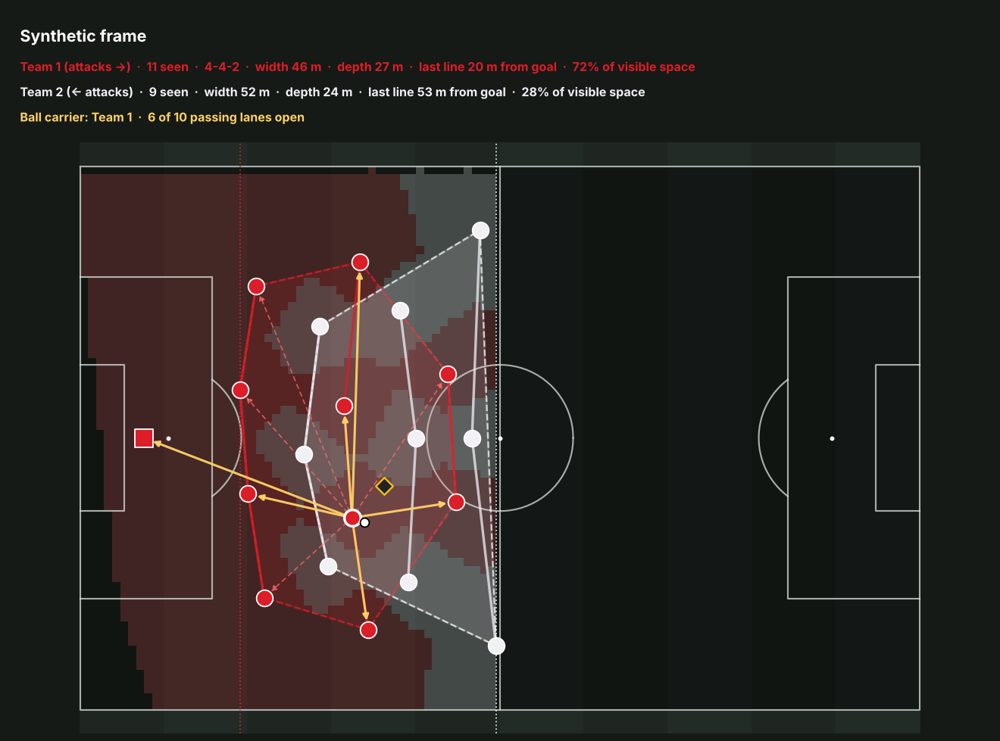

# pitchlens

Map football players from a single broadcast frame onto a 2D pitch, then measure team shape, defensive lines, passing lanes and space control.

It is an open, minimal take on tools like footballhacking: upload a match image, get a top-down tactical picture.



## What it does

1. **Detects people and the ball** with YOLO (COCO `person` and `sports ball` by default; any football-specific model can be swapped in). People off the grass, like the crowd and bench, are dropped with a grass mask.
2. **Splits players into two teams** by shirt colour. It takes the median torso colour in Lab space, ignoring grass pixels, and clusters it. A small third cluster collects referees and goalkeepers, whose kits differ from both teams.
3. **Maps image pixels to pitch metres** with a homography fitted from 4 or more pitch landmarks (corners, penalty box corners, halfway line ends, centre circle points). RANSAC throws out a badly placed landmark and says which one.
4. **Works out the tactics** on the 2D positions:
   - team shape: convex hull, width, depth, centroid;
   - lines (back, midfield, front) and a formation string such as `4-4-2` when all ten outfield players are visible;
   - last line height: how far the deepest outfield player is from their own goal;
   - goalkeeper and referee identification by position;
   - ball carrier and **passing lanes**: open if no opponent is close to the pass line, with more room needed on longer passes;
   - **space control** (nearest-player Voronoi), counted only over the part of the pitch the camera can see.
5. **Draws** the 2D map, plus the frame with the pitch markings projected back onto it. If the projected lines sit on the painted lines, the calibration is good.

## Install

```bash
python -m venv .venv && . .venv/bin/activate
pip install -e ".[app,dev]"
```

The first run downloads `yolo11m.pt` (about 40 MB) from the Ultralytics releases.

## Command line

```bash
pitchlens landmarks                       # list landmark names for calibration files
pitchlens analyse frame.jpg --calib calib.json --out out/
```

This writes `out/frame_pitch.png`, `out/frame_annotated.jpg` and `out/frame.json`. Useful flags:

- `--left-team 1|2` tells it which team defends the left goal. Without it, the side is guessed from positions, which can be wrong when a team presses very high.
- `--weights` lets you use another detector, for example one trained on Roboflow's football players dataset (ball, goalkeeper, player, referee).
- `--keypoint-weights` fits the calibration automatically with a YOLO pose model that predicts the 32 pitch keypoints in Roboflow's order (`football-field-detection` dataset), so no clicking is needed.

### Calibration file

List four or more landmarks with their pixel position. Spread them across the frame. Points on a single straight line don't count as separate.

```json
{"points": [
  {"name": "halfway_far",         "image": [1562, 407]},
  {"name": "halfway_near",        "image": [1606, 1114]},
  {"name": "centre_circle_left",  "image": [1237, 610]},
  {"name": "centre_circle_right", "image": [1920, 622]},
  {"name": "left_box_far_corner", "image": [558, 458]}
]}
```

You can also give any point as `{"pitch": [x, y], "image": [u, v]}` in metres. Pitch coordinates run from the far-left corner: `x` goes 0 to 105 along the touchline, `y` goes 0 to 68 from the far touchline to the near one.

## Web demo

```bash
python app.py   # http://localhost:7860
```

Upload a frame, pick a landmark in the list, click it in the image, repeat, then press **Analyse**. The demo also prints the calibration JSON so you can reuse it with the CLI.

## Example without a model

```bash
python examples/synthetic_demo.py
```

This draws a frame from a known camera with known player positions, runs the pipeline, and writes the images in `docs/`. The tests use the same frame to check that every player lands within 0.5 m of the truth.

## Limits

- **One frame, no motion.** Space control ignores speed and direction, and passing lanes are straight lines. Video, tracking and ball interpolation are the next step; a ball detector alone only finds the ball in a fraction of frames.
- **Calibration is manual** unless you supply a pitch keypoint model.
- **COCO "person" is not trained on football.** It misses some players in crowded areas and finds the ball less often than a football-specific model would.
- **The side each team defends is guessed** unless a goalkeeper is visible or you pass `--left-team`.

## Layout

```
src/pitchlens/
  pitch.py       pitch dimensions, 32 landmarks (Roboflow order) and markings
  homography.py  fit / load / apply the image <-> pitch mapping
  detect.py      YOLO wrapper, grass mask, on-pitch filter
  teams.py       shirt colour clustering, keeper and referee resolution
  tactics.py     shape, lines, passing lanes, space control
  pipeline.py    analyse(): one frame in, Analysis out (and to_dict for JSON)
  render.py      pitch map and annotated frame
  cli.py         `pitchlens` command
app.py           Gradio web demo
tests/           synthetic frame + tests
```
